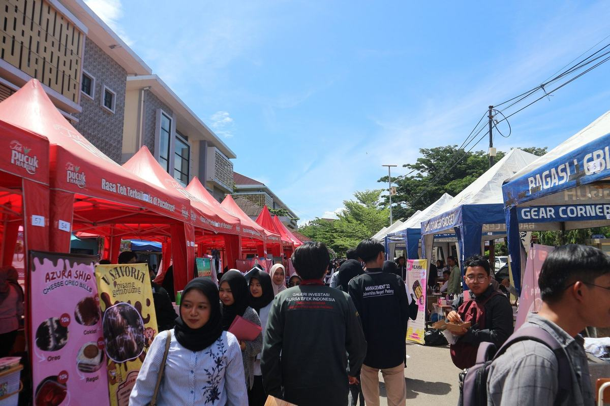

# Website UKM Kewirausahaan UNU Purwokerto

Landing page resmi **Unit Kegiatan Mahasiswa Kewirausahaan Universitas Nahdlatul Ulama Purwokerto**
— Kabinet Akselerasi, periode 2026/2027.

Dibangun dengan HTML, CSS, dan JavaScript murni — **tanpa framework dan tanpa dependensi**,
sehingga ringan, mudah dirawat, dan bisa langsung di-hosting di hosting statis mana pun.

---

## Struktur Proyek

```
Website-ukm-kwu/
├── index.html              # Struktur halaman (satu file)
├── css/
│   └── style.css           # Seluruh gaya, diurutkan per seksi
├── js/
│   └── script.js           # Seluruh interaksi, modular per fitur
├── assets/
│   └── img/                # Logo & foto (sudah dioptimasi)
│       ├── logo-ukm.png / .webp
│       ├── logo-unu.png / .webp
│       ├── logo-danara.png / .webp
│       ├── favicon.png · apple-touch-icon.png · icon-512.png
│       ├── og-image.jpg    # Pratinjau media sosial (1200×630)
│       ├── hero/            # Varian responsif hero
│       │   ├── hero-original.jpg   # ★ master — ganti foto ini
│       │   ├── hero-640.webp / .jpg
│       │   ├── hero-960.webp / .jpg
│       │   ├── hero-1280.webp / .jpg
│       │   ├── hero-1440.webp / .jpg
│       │   └── hero-1920.webp / .jpg
│       ├── about-bootcamp.jpg · about-bootcamp-{700,1400}.webp
│       ├── galeri-*.jpg · galeri-*-1200.webp
│       └── pengurus/       # Slot foto pengurus (lihat di bawah)
│           ├── angga-saputra.jpg
│           ├── lili-khomsatun.jpg
│           └── … (13 file)
├── tools/
│   └── build-media.py      # Regenerasi semua varian gambar
└── README.md
```

> **Mengganti foto hero:** ganti `assets/img/hero/hero-original.jpg`, lalu jalankan
> `python3 tools/build-media.py`. Varian WebP/JPEG, favicon, dan gambar OG
> ikut diperbarui otomatis. Detailnya di bagian [Optimasi Gambar](#optimasi-gambar).

---

## Menjalankan Secara Lokal

Cukup buka `index.html` di browser — tidak ada proses build.

Agar Google Fonts dan gambar dimuat dengan benar (tidak via `file://`), jalankan server statis:

```bash
cd Website-ukm-kwu
python3 -m http.server 8000
# lalu buka http://localhost:8000
```

Alternatif dengan Node.js: `npx serve .`

---

## Isi Halaman

| Section | ID | Isi |
|---|---|---|
| Hero | `#beranda` | Headline, ajakan gabung, dan 4 statistik dengan animasi angka |
| Tentang | `#tentang` | Profil organisasi + 4 pilar (Pelatihan, Praktik, Networking, Leadership) |
| Program | `#program` | 6 kartu program: Workshop, Bootcamp, Bazar, Friendship Journey, Studi Banding, Danara |
| Danara | `#danara` | Unit bisnis semi-otonom, fitur, dan kontak katalog/kerjasama |
| Pengurus | `#pengurus` | Bagan struktur organisasi: Pembina → CEO → 3 divisi → unit Danara, dengan filter per divisi |
| Galeri | `#galeri` | 4 foto dengan lightbox (klik / Enter, panah kiri-kanan, Esc) |
| Gabung | `#gabung` | 3 langkah pendaftaran, FAQ akordeon, dan CTA kontak |

Navigasi utama, menu mobile, tombol WhatsApp melayang, dan tombol *back-to-top* tersedia
di semua halaman. Tampilan menyesuaikan otomatis ke mode terang/gelap mengikuti setelan sistem.

---

## Menyesuaikan Konten

### 1. Warna dan tema

Semua token desain berada di bagian atas `css/style.css`:

```css
:root {
  --green: #0b6b3a;       /* warna utama   */
  --gold:  #f2b01e;       /* warna aksen   */
  --ink:   #15241c;       /* teks utama    */
  --radius: 18px;
  --header-h: 72px;
}
```

Blok `@media (prefers-color-scheme: dark)` di bawahnya mengatur versi gelap.
Ubah nilai di kedua blok tersebut agar tema gelap tetap selaras.

### 2. Teks dan gambar

Seluruh isi halaman ada di `index.html`:

```html
<!-- Ganti foto galeri (format WebP sudah dipakai otomatis oleh <picture>) -->
<picture>
  <source type="image/webp" srcset="assets/img/galeri-bazar-1200.webp" />
  
</picture>

<!-- Ganti kontak WhatsApp (nomor 62857... = format internasional tanpa "+") -->
<a href="https://wa.me/6285713419939?text=Halo...">Daftar via WhatsApp</a>
```

> Selalu isi atribut `width` dan `height` pada `` sesuai ukuran aslinya agar
> browser bisa mereserve ruang dan halaman tidak melompat (layout shift) saat gambar dimuat.
>
> Foto galeri & about memakai `<picture>`: browser otomatis mengambil versi
> **WebP** (lebih kecil ±30%) dan tetap punya fallback JPG untuk browser lama.

### 3. Menambah kartu program / pengurus

Cukup salin blok `<article class="prog rv">` (kartu program) atau `<article class="member …">`
di dalam `.org-branch-body` (kartu pengurus). Elemen berawalan `rv` akan otomatis muncul
dengan animasi saat di-scroll.

Untuk memindahkan orang ke divisi lain, cukup ubah nilai `data-cat` pada `<article class="member">`
dan/atau pindahkan bloknya ke `<section class="org-branch">` yang lain — filter ikut menyesuaikan.

### 4. Menambah aturan CSS

`css/style.css` sudah diurutkan dalam 18 bagian bernomor dengan komentar pemisah.
Tambahkan aturan baru di bagian yang paling sesuai, dan jaga urutannya.

### 5. Bagan struktur organisasi

Section `#pengurus` dibangun sebagai bagan (org chart) murni HTML + CSS — tanpa
pustaka grafik, jadi tetap ringan dan responsif. Semua garis penghubung digambar
dengan CSS murni (`::before`/`::after`), bukan gambar.

```
Pembina UKM ── Agung Prasetyo, S.E., M.Si., M.M.
      │
    CEO  ── Angga Saputra
      │
   ┌──┴───────────────┬────────────────┐
Administrasi    Divisi Internal    Divisi Eksternal
Lili Khomsatun  Rafa Selfiana Putri  Aris Setianingsih H.
(kepala)         (kepala)             (kepala)
Selomita Dita   Dwi Rida Melati      Lilis Setiyani
Pratiwi (staff) Fedora Intan Sheza   (staff)
                (staff)
      ┊  mitra sejajar dengan CEO · koordinasi lintas unit
   Danara — Badan Usaha Semi-Otonom
   Mario Elyansyah (Direktur)
   ├── Eky Reza Saputra (Data Analisis)
   └── Silla Avinnan Setya (Bisnis & Control)
```

Struktur ini mengikuti bagan `bagan-struktur-ukm-kwu.mmd` / `.json`, dengan
penyesuaian: Lili Khomsatun memimpin Administrasi, Rafa Selfiana Putri memimpin
Divisi Internal, dan Aris Setianingsih H. memimpin Divisi Eksternal — sisanya
berstatus staff di divisi masing-masing.

Bagian penting markup:

| Kelas | Peran |
|---|---|
| `.org` | Wadah bagan (flex vertikal, semua node-center) |
| `.org-node--pembina` / `.org-node--ceo` | Node spectroscopic atas |
| `.org-stem` | Garis vertikal penghubung antar node |
| `.org-branches` + `.org-bus` | Baris 3 divisi + garis horizontal "payung" |
| `.org-branch` | Satu kotak divisi (header + daftar orang) |
| `.member--lead` / `.member--staff` | Kartu kepala unit (aksen emas) vs staff |
| `.org-partner` | Label "mitra sejajar" + garis putus-putus ke unit Danara |
| `.org-danara` | Panel Danara (border putus-putus ungu = bukan bawahan) |

Unit Danara sengaja memakai **border putus-putus** dan **label "mitra sejajar"**
karena Danara adalah badan usaha semi-otonom — sejajar dengan CEO, bukan divisi
di bawahnya. Unit ini masih punya filter sendiri (`Danara & Bisnis`).

Untuk menyetel tampilan bagan, ubah variabel di dalam `.org`:

```css
.org {
  --org-line: …;   /* warna garis penghubung */
  --org-gap: 20px; /* jarak antar kotak divisi */
  --org-vgap: 34px;/* panjang garis vertikal */
  --org-blue: #1565c0;   /* aksen divisi   */
  --org-purple: #7b1fa2; /* aksen unit Danara */
}
```

Di layar ≤820 px bagan dirapatkan menjadi satu kolom (garis payung disembunyikan,
setiap divisi diberi garis aksen kiri).

---

## Daftar Fitur JavaScript

Semua modul berada di `js/script.js` dan berjalan sendiri — masing-masing aman dijalankan
walaupun markup terkait tidak ada.

| Modul | Fungsi |
|---|---|
| Header scroll state | Header berubah gaya saat halaman di-scroll |
| Mobile menu | Buka/tutup, klik di luar menutup, tombol Esc menutup |
| Scroll spy | Menyorot link nav sesuai section yang sedang dibaca |
| Reveal on scroll | Elemen `.rv` muncul perlahan saat masuk viewport |
| Animated counters | Angka statistik menghitung naik (format `4.075`) |
| Pengurus filter | Meneutralkan unit bagan yang tidak sesuai filter (diredupkan, bukan dihapus, agar bentuk bagan tetap terbaca) |
| FAQ accordion | Satu panel terbuka pada satu waktu |
| Gallery lightbox | Navigasi foto, panah keyboard, focus trap, compteur |
| Back-to-top | Tombol kembali ke atas muncul setelah scroll 600px |

Semua animasi otomatis dinonaktifkan bila pengguna mengaktifkan
**"Reduce motion"** di pengaturan sistem.

---

## Foto Pengurus

Tiap kartu pengurus punya slot foto lingkaran. **Cukup ganti file-nya** — nama file
harus sama persis, tanpa perlu menyentuh HTML:

| File | Orang | Jabatan di bagan |
|---|---|---|
| `pembina-agung-prasetyo.jpg` | Agung Prasetyo | Pembina UKM |
| `angga-saputra.jpg` | Angga Saputra | CEO |
| `lili-khomsatun.jpg` | Lili Khomsatun | Kepala Administrasi |
| `selomita-dita-pratiwi.jpg` | Selomita Dita Pratiwi | Staff Administrasi |
| `rafa-selfiana-putri.jpg` | Rafa Selfiana Putri | Kepala Divisi Internal |
| `dwi-rida-melati.jpg` | Dwi Rida Melati | Staff Divisi Internal |
| `fedora-intan-sheza.jpg` | Fedora Intan Sheza | Staff Divisi Internal |
| `aris-setianingsih-h.jpg` | Aris Setianingsih H. | Kepala Divisi Eksternal |
| `lilis-setiyani.jpg` | Lilis Setiyani | Staff Divisi Eksternal |
| `mario-elyansyah.jpg` | Mario Elyansyah | Direktur Danara |
| `eky-reza-saputra.jpg` | Eky Reza Saputra | Data Analisis (Danara) |
| `silla-avinnan-setya.jpg` | Silla Avinnan Setya | Bisnis & Control (Danara) |
| `direktur-danara.jpg` | Slot foto tambahan di section Danara | — |

**Syarat foto:**
- Rasio **1:1 (persis persegi)** — foto akan dipotong otomatis oleh `object-fit: cover`
- Resolusi **320 × 320 px** atau lebih (cukup untuk layar retina)
- Format **JPG** (penamaan file sudah `.jpg`)

Kalau foto belum tersedia, file placeholder bawaan sudah dipasang — tampilannya
tetap rapi (siluet di atas latar lembut). **Kalau sebuah file foto dihapus,
halaman tidak akan rusak**: avatar otomatis kembali ke inisial nama (misal `LK`),
tanpa ikon gambar rusak.

Inisial nama tetap ada di belakang foto, jadi kalau foto tidak cocok atau bermasalah,
namanya tetap terbaca.

---

## Optimasi Gambar

Semua gambar sudah diproses: format WebP, varian responsif, dan placeholder blur.
Halaman ini hanya memerlukan **±250 KB** unduhan di koneksi lambat.

### Cara kerjanya

| Teknik | Penjelasan |
|---|---|
| **`<picture>` + `srcset`** | Browser memilih varian paling pas sesuai lebar layar & pixel density. Ponsel 390px hanya menarik 1280w, bukan 1920w. |
| **WebP dengan fallback JPG** | Varian WebP ±30–50% lebih kecil; `<source>` JPG tetap ada untuk browser lama. |
| **`<link rel="preload">`** | Hero mulai diunduh sebelum CSS selesai diparsing → LCP lebih cepat. |
| **LQIP (blur placeholder)** | Hero punya background blur 20×20 (512 byte, inline di CSS) yang langsung tampil sebelum foto selesai diunduh. |
| **Favicon khusus** | Logo 320px (87 KB) **tidak lagi** dipakai sebagai favicon — sudah diganti file 64/180/512px kecil. |
| **Gambar OG 1200×630** | Pratinjau media sosial memakai rasio standar, bukan foto 3:2. |

### Angka hasil (diukur dengan Chrome headless)

| | Sebelum | Sesudah | Selisih |
|---|---|---|---|
| Unduhan hero (desktop 1440px) | 344 KB | 119 KB | **−65%** |
| Unduhan hero (ponsel 390px) | 344 KB | 99 KB | **−71%** |
| Total gambar | 769 KB | 203 KB | **−74%** |
| Total halaman | 815 KB | 251 KB | **−69%** |
| LCP (Slow 4G) | 5048 ms | 2148 ms | **−57%** |

### Mengganti foto

Cukup ganti file **master**, lalu jalankan:

```bash
python3 tools/build-media.py
```

Yang perlu diedit hanya:

| File master | Menghasilkan |
|---|---|
| `assets/img/hero/hero-original.jpg` | 5 varian WebP + 5 JPEG, LQIP di CSS, dan `og-image.jpg` |
| `assets/img/logo-ukm.png` | `favicon.png`, `apple-touch-icon.png`, `icon-512.png` |
| `assets/img/about-bootcamp.jpg` | varian WebP 700w & 1400w |
| `assets/img/galeri-*.jpg` | varian WebP 1200w |

Butuh **Pillow** (`pip install pillow`). Semua file lain di `assets/img/` adalah
hasil generate — jangan diedit manual.

> **Rasio foto hero:** 3:2 (1920×1280 ideal). Layar lebar memotong bagian atas
> dan bawah otomatis karena `object-fit: cover` dengan titik fokus `center 40%`.

---

## Deploy

Semua berkas statis, jadi bisa langsung di-hosting di:

- **GitHub Pages** — push ke repo, aktifkan Pages pada branch `main`.
- **Netlify / Vercel** — seret folder ke dashboard, tidak perlu build command.
- **Hosting cPanel/FTP** — unggah isi folder ke `public_html`.

Tidak ada proses build, `npm install`, atau konfigurasi tambahan.

---

## Checklist Sebelum Publish

- [ ] Ganti semua nomor WhatsApp dan alamat email dengan kontak resmi
- [ ] Ganti foto ilustrasi dengan foto kegiatan asli (perbarui `alt` teksnya)
- [ ] Perbarui nama beserta struktur pengurus bila ada pergantian kabinet
- [ ] Ganti `assets/img/hero/hero-original.jpg` untuk banner hero (rasio 3:2), lalu jalankan `python3 tools/build-media.py`
- [ ] Periksa tautan sosial media di footer
- [ ] Uji tampilan pada mobile, tablet, dan desktop

---

© 2026 UKM Kewirausahaan UNU Purwokerto — Kabinet Akselerasi.
